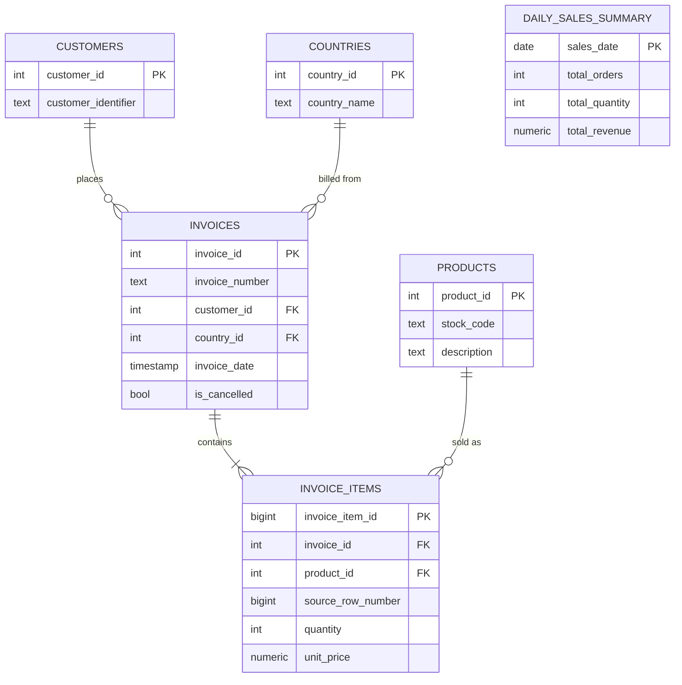

# PostgreSQL ETL Pipeline with Apache Airflow

A local, end-to-end batch ETL pipeline: it extracts the UCI Online Retail
dataset from Excel, cleans and validates it in Python, loads it into a
normalised PostgreSQL schema, and orchestrates the whole thing with
Apache Airflow — plus SQL analytics, automated tests, backup/restore, and
a measured indexing benchmark. Runs entirely on Docker, no paid services.

## Quickstart

```bash
git clone https://github.com/MANCSRIVASTAVA/postgresql-airflow-etl.git
cd postgresql-airflow-etl

# 1. Place the dataset (see "Dataset" below)
#    -> data/Online Retail.xlsx

# 2. Configure environment
cp .env.example .env
# edit .env: set real POSTGRES_PASSWORD, _AIRFLOW_WWW_USER_PASSWORD,
# FERNET_KEY and AIRFLOW_JWT_SECRET (generation commands are in .env.example)

# 3. Bring up Postgres + Airflow (5 services, LocalExecutor)
docker compose up -d

# 4. Open the Airflow UI
open http://localhost:8080   # log in with _AIRFLOW_WWW_USER_USERNAME / _PASSWORD from .env

# 5. Trigger the pipeline
docker compose exec airflow-scheduler airflow dags unpause retail_etl_pipeline
docker compose exec airflow-scheduler airflow dags trigger retail_etl_pipeline
```

Local Python work (running tests, calling the ETL modules directly) needs
its own virtualenv:

```bash
python3 -m venv .venv && source .venv/bin/activate
pip install -r requirements.txt
pytest -q
```

## Schema



3NF for the transactional tables; `daily_sales_summary` is a deliberate
denormalised reporting rollup. Full rationale in
[docs/er_diagram.md](docs/er_diagram.md).

## Business problem

A retailer's transaction log is a single flat export — no customer
dimension, no product catalogue, no separation between a sale and its
cancellation. Nobody can cheaply answer "what was yesterday's revenue by
country" or "who are our top 10 customers" against a flat file without
scanning it from scratch every time, and a naive import would double-count
every cancelled order as both a sale and a reversal. This project turns
that flat export into a queryable, normalised model with revenue rules
that are correct by construction, refreshed on a schedule.

## Dataset

[UCI Online Retail dataset](https://archive.ics.uci.edu/dataset/352/online+retail)
— 541,909 transactions, 8 columns (`InvoiceNo`, `StockCode`, `Description`,
`Quantity`, `InvoiceDate`, `UnitPrice`, `CustomerID`, `Country`), December
2010–December 2011, a UK-based online gift retailer.

Not included in this repository (23MB+, and not something that belongs in
git). Download it and place it at `data/Online Retail.xlsx` before
running the pipeline — the folder structure is already there
(`data/.gitkeep`), just the file itself is missing until you add it.

## Technology stack

Python 3.13, pandas, SQLAlchemy 2.0, psycopg 3, PostgreSQL 16, Apache
Airflow 3.4.0 (LocalExecutor), Docker Compose, pytest, bash.

## ETL workflow

```
Excel (.xlsx)
  -> extract.py       read + verify columns, tag each row with its
                       source_row_number (the natural key everything
                       downstream upserts on)
  -> transform.py      clean, validate, flag cancellations/returns,
                       compute line revenue — nothing silently dropped
  -> load.py            staging (truncate + COPY) -> dimensions
                       (upsert) -> invoices/invoice_items (bulk upsert
                       via a temp table) -> daily_sales_summary refresh
  -> validation.py     missing-value/duplicate/referential-integrity
                       checks + source-to-DB row count reconciliation;
                       a critical failure raises and fails the task
```

Rerunning the whole pipeline on the same file never creates duplicates —
every load is keyed on a natural identifier (`source_row_number`,
`invoice_number`, `stock_code`/`country_name`/`customer_identifier`) that
exists independently of any ID the database assigns.

## Airflow DAG

`dags/retail_etl_pipeline.py`, DAG id `retail_etl_pipeline`, 8 tasks:

```
extract_data -> validate_raw_data -> transform_data -> load_staging
  -> load_dimensions -> load_transactions -> generate_daily_summary
  -> run_quality_checks
```

Built with the TaskFlow API. Intermediate data (the 500k+ row dataset)
moves between tasks as Parquet files on a shared volume — never through
XCom, which is for small metadata, not datasets. 3 retries, 2-minute
retry delay, daily schedule, runnable on demand.

## Data quality rules

- **Cancellations:** an `InvoiceNo` starting with `C` marks the whole
  invoice cancelled. Excluded from every revenue calculation.
- **Returns:** a negative `Quantity` on a non-cancelled invoice is a
  legitimate return, kept (never blindly deleted) — it reduces revenue
  naturally once `quantity * unit_price` is negative.
- **Duplicates:** an exact duplicate across all 8 source columns is
  removed, keeping the first occurrence. Two rows for the same
  invoice/product with a *different* quantity are two distinct line
  items, not duplicates.
- **Missing values:** a missing `CustomerID` is kept as a guest purchase
  (nullable FK); a missing core field (`InvoiceNo`, `StockCode`,
  `Quantity`, `UnitPrice`, `InvoiceDate`) is rejected with a reason, never
  silently dropped.

## SQL analytics

`sql/01` through `sql/06`: schema, tables, indexes, views
(`vw_daily_sales`, `vw_monthly_sales`, `vw_top_products`), the
`refresh_daily_sales_summary()` procedure, and 8 analytics queries
(daily/monthly revenue, top 10 products/customers, revenue by country,
invoice totals, cancellations, returns). Every revenue calculation
excludes cancelled invoices and keeps legitimate returns, consistently.

## Performance

Indexes were added *after* measuring a baseline, not before. Two
selective queries got 6-9x faster; three full-table aggregation queries
showed no real improvement, because indexing can't help a query that has
to touch nearly every row anyway. Full measured results, real
`EXPLAIN ANALYZE` output, and the reasoning: [docs/performance_analysis.md](docs/performance_analysis.md).

## Backup & recovery

```bash
./scripts/backup.sh                              # -> backups/retail_db_<timestamp>.dump
./scripts/restore.sh backups/retail_db_<ts>.dump  # restores + verifies row counts
```

Details: [docs/recovery_guide.md](docs/recovery_guide.md).

## Project structure

```
dags/retail_etl_pipeline.py   Airflow DAG
src/                          extract, transform, load, validation, database
sql/                           schema, tables, indexes, views, procedures, analytics
scripts/                       backup.sh, restore.sh
tests/                         pytest suite (34 tests)
docs/                          architecture, data dictionary, ER diagram,
                               performance analysis, recovery guide
docker-compose.yaml            Postgres + 5-service Airflow stack
Dockerfile                     extends apache/airflow:3.4.0 with this project's deps
```

## Screenshots

_To add: Airflow UI DAG graph view, a successful DAG run, Postgres tables
via a client, `EXPLAIN ANALYZE` output before/after indexing._

## Future improvements

- Scheduled backups (currently manual, via `backup.sh`)
- A materialised rollup for top-products/revenue-by-country, the way
  `daily_sales_summary` already works, since those queries don't benefit
  from indexing alone (see [docs/performance_analysis.md](docs/performance_analysis.md))
- CI (GitHub Actions) running `pytest` on every push
- Splitting Airflow's metadata database from `retail_db` onto separate
  Postgres instances, the way a production deployment would
