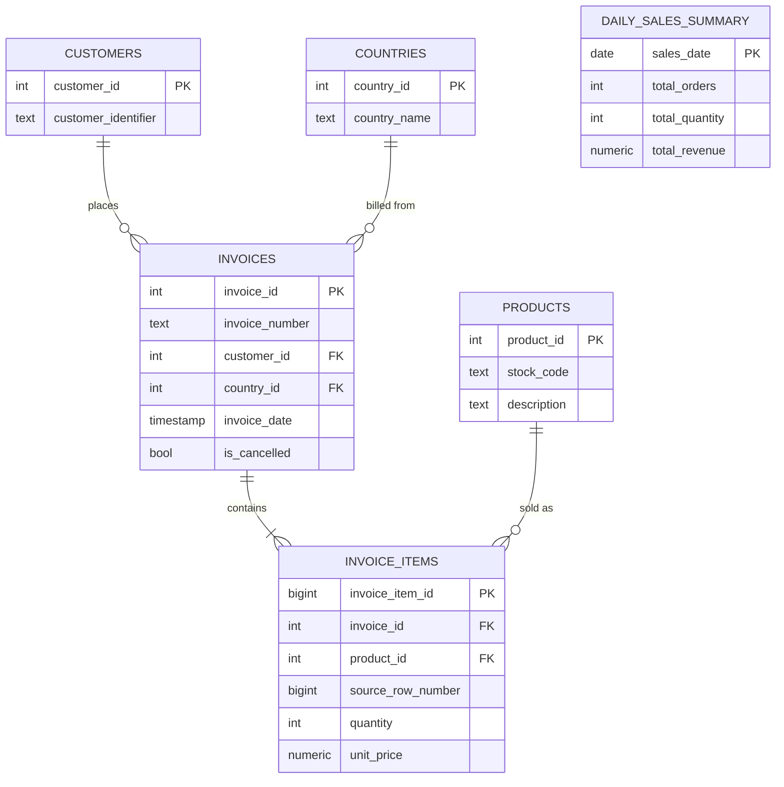

# Entity-Relationship Diagram

## 3NF vs. deliberate denormalisation

`customers`, `countries`, `products`, `invoices` and `invoice_items` are in
3NF: every non-key column depends on the whole key and nothing but the key.
Revenue is never stored on `invoice_items` — it's `quantity * unit_price`,
computed wherever it's needed, so there's no derived value that can drift
out of sync with its inputs.

`daily_sales_summary` is the one deliberate exception. It's a materialised,
denormalised rollup that duplicates information already derivable from
`invoices`/`invoice_items`, and it's refreshed wholesale per date by
`refresh_daily_sales_summary()` rather than kept normalised. That's a
reporting-table trade-off, not an oversight: scanning 500k+ line items to
answer "what was yesterday's revenue" every time a dashboard loads is wasted
work once the numbers for a closed day are final.
